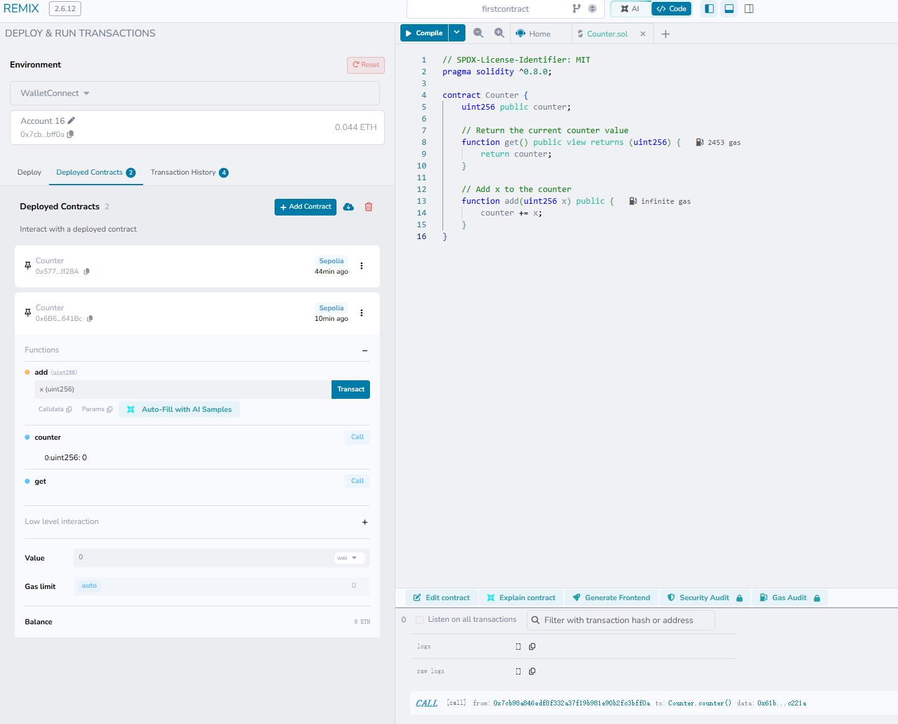
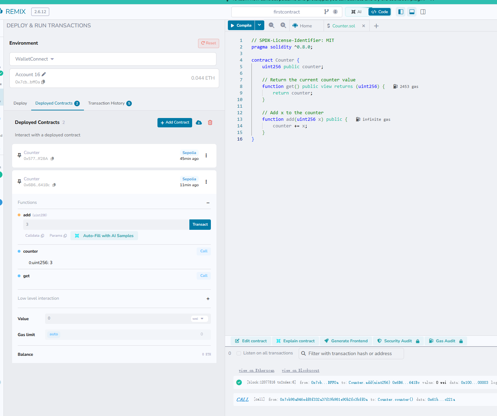
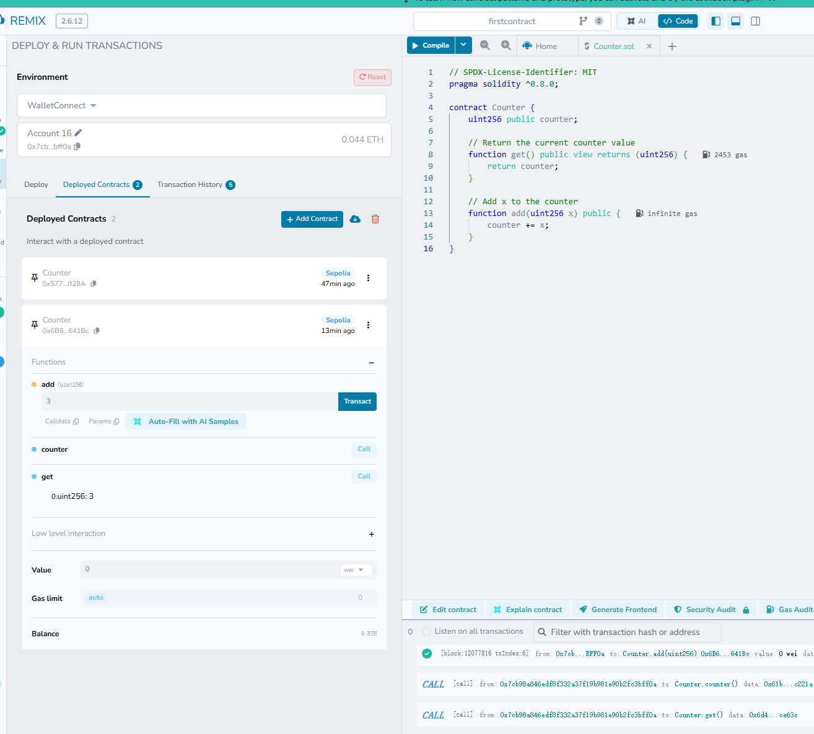
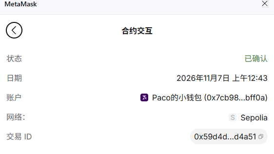

# 截图与交易 Hash

- 网络：Sepolia 测试网
- 钱包地址：`0x7cb98a846edf8f332a37f19b981e90b2fc3bff0a`
- Counter 合约地址：[`0x6b61783f27810db251a4e992033be698115641bc`](https://sepolia.etherscan.io/address/0x6b61783f27810db251a4e992033be698115641bc)

| 步骤 | 交易 Hash |
|---|---|
| 1. 转账 0.001 SepoliaETH | [`0x6ddbca41…3dc9f`](https://sepolia.etherscan.io/tx/0x6ddbca41a2b409a2d29369da28774a8e5ea51a63852013fa72a430bda5f3dc9f) |
| 2. 部署 Counter 合约 | [`0xdc624170…6191d`](https://sepolia.etherscan.io/tx/0xdc6241704a8f0568f673c711897f140e680946de12d26d61fe6f6ed74036191d) |
| 3. 调用 `add(3)` | [`0x59d4d51d…d4a51`](https://sepolia.etherscan.io/tx/0x59d4d51ded7ceedc5b0dbe7b6c60c8729ab58aba23b95e2e5185d9e731ed4a51) |

## 1. 任意地址转账

向 `0x3d4cd2a4a64978345713f9fbc8d64a29079365e2` 转账 0.001 SepoliaETH。

钱包中的转账记录（交易 ID `0x6ddbc…3dc9f`）：

交易 Hash：[`0x6ddbca41a2b409a2d29369da28774a8e5ea51a63852013fa72a430bda5f3dc9f`](https://sepolia.etherscan.io/tx/0x6ddbca41a2b409a2d29369da28774a8e5ea51a63852013fa72a430bda5f3dc9f)

## 2. 使用 Remix 部署 Counter 合约

Remix 中通过 WalletConnect 连接钱包，将 `Counter.sol` 部署到 Sepolia，新合约出现在 Deployed Contracts 中（`0x6B6…641Bc`）：

钱包中的部署交易（交易 ID `0xdc624…6191d`）：

交易 Hash：[`0xdc6241704a8f0568f673c711897f140e680946de12d26d61fe6f6ed74036191d`](https://sepolia.etherscan.io/tx/0xdc6241704a8f0568f673c711897f140e680946de12d26d61fe6f6ed74036191d)

## 3. 调用 add(x) 方法

调用前，`counter` 为 `0`：

在合约 `0x6B6…641Bc` 上调用 `add(3)` 后，`counter` 变为 `3`：

调用 `get()` 读出 `counter` 的值，返回 `3`：

钱包中的 `add(3)` 交易（交易 ID `0x59d4d…d4a51`）：

交易 Hash：[`0x59d4d51ded7ceedc5b0dbe7b6c60c8729ab58aba23b95e2e5185d9e731ed4a51`](https://sepolia.etherscan.io/tx/0x59d4d51ded7ceedc5b0dbe7b6c60c8729ab58aba23b95e2e5185d9e731ed4a51)
